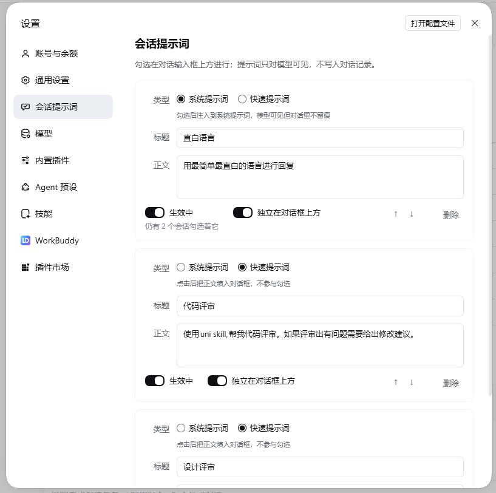

# dsh-session-prompts

给 DSH 加一层「可临时挂上去的系统提示词」。在配置页维护一批提示词，在对话输入框上方按会话勾选，
勾上的那些从下一次请求开始进入该会话的**系统提示词**。

<p align="center">
  
</p>

在输入框上方勾选，勾上的提示词从下一次请求开始注入本会话的系统提示词——对话记录里不留痕迹。

## 特性

- **按会话勾选**：勾选状态逐会话记忆，A 会话勾的不影响 B 会话；子会话沿 `parentSession` 自动继承父会话的勾选。
- **走系统提示词注入**：模型能看到，但对话记录里不会多出一条用户消息，也不占对话历史的位置；关掉插件后会话里不留任何注入痕迹。
- **两层勾选界面**：重要的提示词可「独立在对话框上方」常驻成一行，其余收进折叠组，一行显示「已挂 N 条」。
- **真开关**：「生效中」关掉即刻停止注入（不只是界面隐藏），勾选记录保留、重开后自动恢复。
- **数据安全**：状态文件原子写入（临时文件 + rename）；文件损坏时整体进入只读保护，绝不静默清空，修复后点「重试」即恢复。
- **即装即用**：纯 ESM JavaScript，无构建步骤，随 DSH 插件体系安装/卸载，卸载不残留。

最常见的用法是临时的、试验性的约束：这个会话我要它「回答一律用中文」、「做代码审查时只报问题
不给改写建议」。这些约束不该污染别的会话。

## 界面

插件有两处界面：设置页管提示词的增删和开关，输入框上方的勾选区管每个会话挂哪几条。

### 1. 设置 → 会话提示词

设置面板左侧导航里的独立一页，排在「通用」之后：

<p align="center">
  
</p>

在这里：

- 新增、编辑、删除提示词（标题 + 正文，行内编辑，改完自动保存）。
- 管两个开关：
  - **生效中** / 已停用 —— 这是**真开关**。关掉即刻停止注入，不只是界面隐藏；
    勾选记录会保留，重新打开后勾选自动恢复。
  - **独立在对话框上方** —— 决定这条在输入框上方是常驻成一行，还是收进折叠组里。
- 空状态提示与「添加提示词」按钮、删除按钮也在这里。
- 某条提示词开着「生效中」且仍被 N 个会话勾选着时，它的开关下方会提示「仍有 N 个会话勾选着它」。
  这**不阻塞**任何操作，只是别让人意外。

### 2. 对话输入框上方的勾选行

一个会话内的第二处界面，就是勾选的地方（见顶部截图）。分两层渲染：

- **独立行**（开了「独立在对话框上方」的）：每条一行常驻，`☑ 标题` / `☐ 标题`。
  没勾也显示，否则就没有入口去勾它。按 `order` 升序排列。
- **折叠组**（其余全部）：一行 `提示词 · 已挂 N 条`（一条都没挂时只显示 `提示词`），
  点开展成勾选框列表；组内条目也按 `order` 升序。

独立行在上，组行在下。两层都为空时整块不渲染，不留空白。

「已挂 N 条」**只数折叠组里被勾的条目**——独立行已经自己显示了自己，重复计数会让人对不上账。

勾选/取消是点下立即翻转、同时发请求；写失败则该行回滚，并在这一行下面内联报错。

## 「生效中」与「独立在对话框上方」的语义

两个开关是**不同维度**，不要混：

| 开关 | 管什么 | 作用域 |
|---|---|---|
| 生效中 | 是否**注入正文**，以及是否出现在勾选区 | 跨会话（这条提示词的性格） |
| 独立在对话框上方 | 在勾选区里是**常驻成行**还是收进折叠组 | 跨会话 |
| 勾选 | 这条提示词**对这个会话**是否生效 | **按会话** |

状态矩阵：

| 生效中 | 独立显示 | 本会话勾选 | 对话框上方的样子 |
|---|---|---|---|
| 关 | 必为关 | 任意 | 不出现（勾选记录保留） |
| 开 | 关 | 未勾 | 收在组内 `☐ 标题`；组折叠时只体现为不计数 |
| 开 | 关 | 已勾 | 收在组内 `☑ 标题`；折叠时计入「已挂 N 条」 |
| 开 | 开 | 未勾 | 独立一行 `☐ 标题`，常驻 |
| 开 | 开 | 已勾 | 独立一行 `☑ 标题`，常驻 |

### 约束：`pinned ⇒ enabled`

**只有开着「生效中」的提示词才能独立显示在对话框上方。** 所以不存在「关 + 开」那一行。

这条不变式在两处强制：

1. **配置页交互**。「已停用」状态下「独立在对话框上方」呈灰态，点击不切换，而是弹提示框
   要求先开「生效中」，并提供一个「开启并独立显示」的按钮一步到位。
   **反向也成立**：从开着的「生效中」关掉时，如果这条正独立显示，会**一并取消独立显示**，
   并在卡片上给一条提示「已关闭「生效中」，同时取消了独立显示」（4 秒自动消失，不弹模态）。
2. **宿主侧持久化归一化**。每次读写都过一遍状态清洗，`pinned: true` 且 `enabled: false`
   的记录会被**降级**成 `pinned: false`，防止手工改 JSON 或旧数据把它变成非法状态。

## 勾选按会话记，以及子会话继承

勾选状态存在插件自己的 JSON 里，`ticks` 是 `会话 id -> 提示词 id 数组` 的映射。

- **本会话有自己的记录就用自己的**，哪怕是空数组。
- **本会话没有记录**时，沿会话头的 `parentSession` 向上找，用**最近的**有记录的那个祖先。
  所以**子 agent 派生的子会话**会继承父会话的勾选。
- **空数组是一个有效的、明确的值**，表示「这个会话一个都不要」，**不再向上继承**。
  这是子会话显式拒掉父会话勾选的唯一手段。
- `parentSession` 链若成环（数据损坏），遍历会提前收住，不会卡住。

关于 fork，准确的边界是这样（依据宿主 `@deepseek-ai/dsh-session` 的说明）：

- **新 fork 出来的会话不继承勾选。** 宿主的 `fork()` 会复制历史、`cwd`、`isSeeded` 与已继承的
  事件数，但**不记录来源关系**——新会话头上没有 `parentSession`，继承链从它这里就断了，
  它以「没有任何自己的勾选记录、也没有父链接」开始。
- **`parentSession` 记录的是 subagent 的直接创建者**，所以 subagent 派生的子会话才继承。
- **历史遗留的普通 fork 可能仍带着 `parentSession`。** 这类旧数据（早期版本写下的会话头）在
  本插件看来与 subagent 谱系没有区别，因此它们**仍可能**继承到父会话的勾选。
  这是那份数据本身的形态，不是本插件的逻辑。

补充：链上没有勾选信息时退化为「不继承」，不会报错。若某条子 agent 的创建路径不设置
`parentSession`，继承就失效——这是已知的行为，不是错误。

## 状态文件

```
$DSH_HOME/plugin-data/dsh-session-prompts.json
```

`DSH_HOME` 未设置（或为空）时回退 `~/.dsh`，即 `~/.dsh/plugin-data/dsh-session-prompts.json`。

**这是推断出来的路径约定，不是 DSH 的公开 API**：与 `dsh-connect-workbuddy` 等插件遵循的
「`$DSH_HOME` 优先、否则 `~/.dsh`」同语义。两者一致，所以放在一起使用不会分叉。

文件内容形如：

```jsonc
{
  "version": 1,
  "prompts": [
    {
      "id": "…",          // 宿主生成的随机 id，不复用
      "title": "回答用中文",
      "text": "…",        // 注入的正文
      "enabled": true,    // 生效中
      "pinned": false,    // 独立在对话框上方
      "order": 0
    }
  ],
  "ticks": { "<sessionId>": ["…"] }
}
```

写入是**原子**的（临时文件 + rename），失败会回滚内存并让界面回退，不会出现「界面说存了、磁盘上没有」。

删掉这个文件等于清空所有提示词与勾选记录；插件会在下次写入时重新建它。

### 文件损坏时不会静默清空

文件存在、但**解析不了**（手工编辑漏了逗号、被别的工具截断等）时，本插件**不会**把它当成
「你没有提示词」：

- 读取仍然成功，但回答里带 `corrupt: true`，配置页显示一条读取失败的错误，**不显示空状态、
  不提供「添加提示词」**，勾选区也不渲染成空列表。
- **所有写入一律拒绝**（HTTP 500 + 可读原因），状态文件**原样保留**——里面的字节可能还能手工
  救回来（补个括号、删掉半行），一次静默保存就把它变成 `{ "prompts": [] }` 了。
- **修复方式：在应用运行时直接改磁盘上那份 JSON**（补好括号、删掉半行），存盘后回到
  设置页点错误条上的「**重试**」。这个按钮会请求宿主**重新从磁盘读一次**
  （`POST /plugins/dsh-session-prompts/reload`），成功之后损坏标记消失、写入恢复可用，
  不需要重启应用。

  如果暂时不想修，也可以把文件**改名备份**、让插件在工作区里重建一份空的；但请**先确认**
  另一份副本已经在手上，并且**只在插件仍然报着损坏错误、或应用已退出**时操作——
  应用运行期间插件持有的是内存快照，外面怎么动文件，都要靠上面那次「重试」才会被重新读到。

  > 为什么必须点「重试」而不是刷新页面：**刷新浏览器只是重新向宿主发一次 `GET /state`，
  > 而那条路由回答的是宿主的内存快照**，与磁盘无关。只有 `/reload` 会真正重新读盘。
  > 应用启动之后再出现的损坏同样如此。

只有「文件不存在」才等同于「没有提示词」；这与「读不了文件就报错、不假装空」是同一条原则。

## 已知限制

1. **改勾选会损失 provider 侧的 KV cache 复用。** 提示词注入在系统提示词前缀里，
   勾选一变、前缀就变，**从改动点往后**的缓存无法复用。这是本功能的固有成本，
   不是实现缺陷——临时约束的代价就是一次前缀变更。

2. **只接受本机（loopback）请求。** 四个 HTTP 路由只服务本机回环地址
   （`::1`、`127.0.0.0/8` 及其 IPv4 映射形式），其它来源一律拒绝。
   因此**用远程浏览器打开 GUI 时，勾选区不会渲染**（读状态被拒，它按「没有数据」处理，
   整块不出现），配置页则显示一条读取失败并可点「重试」。桌面端与本机浏览器不受影响。

3. **勾选区与配置页借助宿主的三个私有未文档化 CSS 变量来与输入框卡片对齐**：
   `--dsh-composer-side-clearance`、`--dsh-composer-dock-inset`、`--dsh-composer-card-max-width`。
   它们只承载长度、不含颜色，也是宿主自带 todo/goal/queue 三个 dock 用的同一套宽度契约；
   但它们是**宿主私有**的。宿主若改名或去掉，`calc()` 会失效，勾选区宽度会**回落为 `auto`**
   （内容仍可用，只是不再与输入框卡片左右对齐）。

4. **注入的正文会经过 profile 里其它挂在 `system-prompt/assemble` waterfall 上的插件。**
   本插件不碰那个 waterfall，但注入的正文会流经它。例如 `codebuddy-prompt-shim`
   会做逐句改写（拆行等），**因此模型看到的可能是被改写后的版本**，
   而不是你在配置页里写的那份逐字原文。这是既有插件的既有行为，本插件不处理。

5. **勾选状态不写会话日志**——这是有意为之。在会话日志里新增事件类型需要 `ignorable: true`，
   而实时 append 设不了这个标记，会导致那个会话**再也打不开**。
   代价是：勾选状态**不参与 fork 回放**，只能靠 `parentSession` 继承在 subagent 谱系上获得近似行为
   （fork 出来的会话拿不到，见限制 7）；
   也无法从对话记录里回溯「这一轮到底挂没挂提示词」——状态只存在于输入框上方那一行。

6. **删除提示词会保留它的勾选记录，且 id 不复用。** 残留的 id 在读取时会被过滤掉，
   既不产生任何注入文本，也不会报错；不需要清理逻辑。重新创建一条提示词拿到的是**新的 id**，
   所以「重新创建同一条」不会复活原来的勾选。

   为此，**带 id 的写入只接受已存在的 id**：给一个不存在的 id 发 upsert 会被拒绝（HTTP 409），
   而不是「顺手创建一条」。这样另一个标签页或桌面端也无法把刚删掉的提示词按原 id 复活，
   否则它会立刻被重新注入到所有还勾着它的会话里。新建提示词只走「不带 id」这一种请求。

7. **fork 出来的会话不继承勾选。** 宿主的 `fork()` 不记录来源关系，新会话头上没有
   `parentSession`，所以它以自己的空勾选集开始（手动勾选一次即可，之后的勾选是它自己的）。
   继承只发生在 subagent 派生的子会话上。历史遗留的普通 fork 若仍带着 `parentSession`，
   则仍可能继承——见「勾选按会话记，以及子会话继承」一节。

8. **状态文件损坏时功能整体只读，恢复要主动点「重试」。** 文件解析失败时读取仍可用
   （界面明确报错），但任何写入都会被拒绝，否则就会覆盖掉仍可手工恢复的数据。
   插件在启动时读一次文件，之后所有读写都答内存里的那份快照；**刷新浏览器不会重新读盘**，
   唯一能重新读磁盘的是设置页错误条上的「重试」（`POST …/reload`）。
   所以正确顺序是：改好磁盘上的 JSON → 点「重试」；仍然报错就说明文件还是坏的。
   应用启动时**读不了**文件（权限、路径是个目录）也是同一套恢复路径：障碍清掉后点「重试」即可，
   不必重启应用。若你更愿意重启应用，那同样有效。

## 卸载

用 **Plugin Manager**（**设置 → 内置插件**，或侧栏「插件」页里管理已安装的组合包）移除
`dsh-session-prompts` 这个 bundle。插件卸载时会把注册的系统提示词段、HTTP 路由、样式与
文案字典都清干净——它**不会**在会话记录里留下任何无法解析的事件，所以卸载不影响任何会话的打开。

卸载**不会**自动删除状态文件。想彻底清干净的话，可选：

```
# $DSH_HOME 未设置时用 ~/.dsh/plugin-data/dsh-session-prompts.json
rm "$DSH_HOME/plugin-data/dsh-session-prompts.json"
```

保留它也无害：插件不在时没有任何东西读它。

## 存储说明

插件**自建存储**：只用自己那份 `plugin-data/dsh-session-prompts.json`，
**不读写** profile 的 `cordis.patch.yml`（包内的 `cordis.patch.yml` 只是给安装器用的入口声明，
安装完就不再参与运行时）。

## 开发

无构建步骤，纯 ESM JavaScript。宿主侧是多文件模块；浏览器侧 `client.js` 是单文件自包含产物。

```
cd dsh-session-prompts
node --test 'test/*.test.js'
```

## 许可

MIT
